### Fase 1. Preparació de l'entorn

Per al client utilitzarem Zorin OS 18 amb configuració de xarxa NAT. El servidor tindrà una interfície amb xarxa només amb amfitrió i l'altra amb xarxa NAT. Això permetrà que el client tingui accés a Internet i que el servidor pugui comunicar-se amb ell.

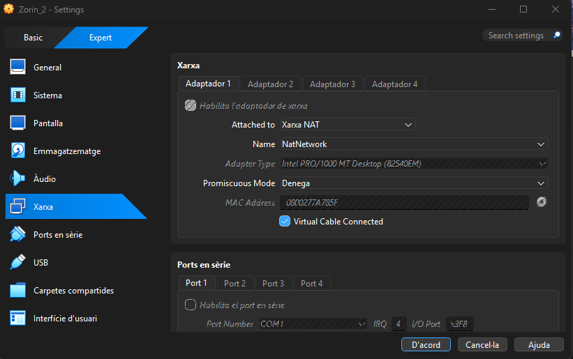

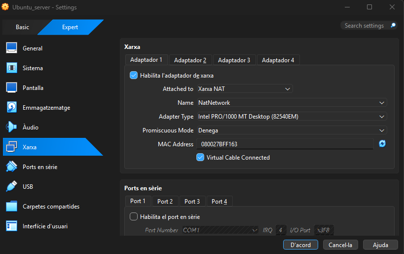

Ens assegurarem que ambdues màquines tinguin accés a Internet i que es puguin comunicar entre elles a través de la xarxa només-amb-amfitrió. També actualitzarem els sistemes amb les últimes actualitzacions disponibles.

### Fase 2: Preparació del servidor

Abans de compartir recursos, preparem els usuaris, els grups i els directoris al servidor i al client.

1. Creació de grups: `devs` i `admins`.

   **Servidor:**
   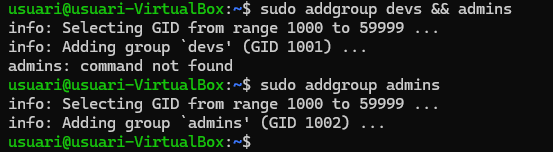

   ```bash
   sudo addgroup devs
   sudo addgroup admins
   ```

   **Client:**
   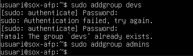

   ```bash
   sudo addgroup devs
   sudo addgroup admins
   ```

2. Creació d'usuaris `dev01` i `admin01`.

   **Client — assignació als grups:**
   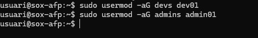

   ```bash
   sudo usermod -aG devs dev01
   sudo usermod -aG admins admin01
   ```

   **Servidor — creació d'usuaris:**
   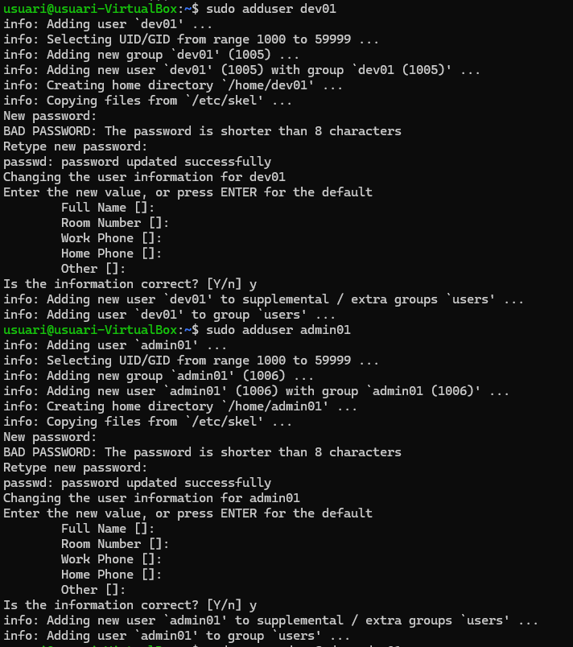

   ```bash
   sudo adduser dev01
   sudo adduser admin01
   ```

3. Creació de directoris al servidor:

   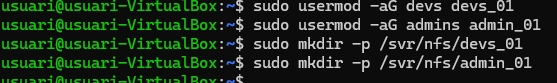

   ```bash
   sudo mkdir -p /srv/nfs/dev_projects
   sudo mkdir -p /srv/nfs/admin_tools
   ```

4. Comprovació de propietaris i permisos:

   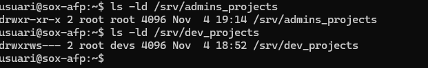

   ```bash
   ls -ld /srv/nfs/dev_projects
   ls -ld /srv/nfs/admin_tools
   ```

5. Instal·lació del servei NFS al servidor i del client NFS al client.

   **Servidor:**
   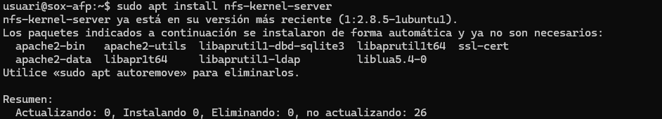

   ```bash
   sudo apt install nfs-kernel-server
   ```

   **Client:**
   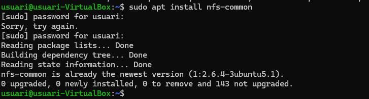

   ```bash
   sudo apt install nfs-common
   ```

> Nota: Perquè aquesta pràctica funcioni correctament, cal replicar aquests usuaris i grups al client i assegurar que UID i GID coincideixen a les dues màquines.

### Fase 3: L'exportació d'administració (el dilema de `root_squash`)

El client necessita accedir a `/srv/nfs/admin_tools`. Aquesta fase mostra la configuració de les exportacions i les proves des del client.

1. Al servidor, configurar i recarregar les exportacions NFS.

   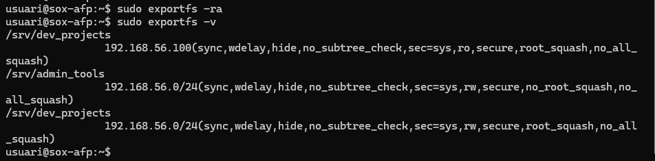

   ```bash
   sudo exportfs -ra
   sudo exportfs -v
   ```

2. Al client, provar l'escriptura indicada a la captura.

   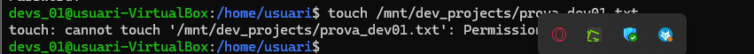

   ```bash
   touch /mnt/admin_tools/prova_root.txt
   ```

3. Al client, comprovar els recursos muntats.

   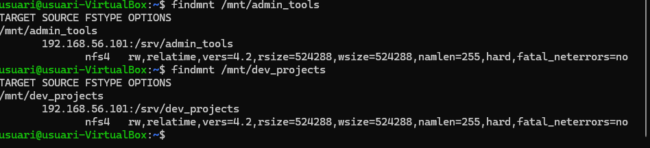

   ```bash
   findmnt /mnt/admin_tools
   findmnt /mnt/dev_projects
   ```

### Fase 4: L'exportació de desenvolupament (permisos `rw` vs `ro`)

1. Al client, provar de muntar el recurs NFS de desenvolupament.

   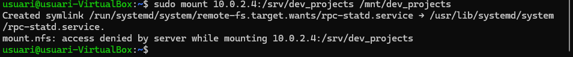

   ```bash
   sudo mount 10.0.2.4:/srv/dev_projects /mnt/dev_projects
   ```

2. Com a `dev01`, provar d'escriure al directori compartit.

   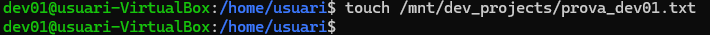

   ```bash
   touch /mnt/dev_projects/prova_dev01.txt
   ```

3. Com a administrador al client, comprovar la denegació d'escriptura.

   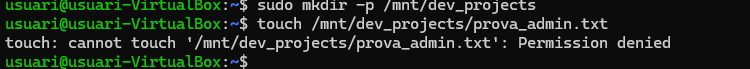

   ```bash
   sudo mkdir -p /mnt/dev_projects
   touch /mnt/dev_projects/prova_admin.txt
   ```

4. Es pot desmuntar el recurs amb:

   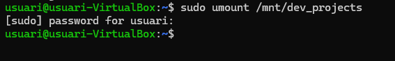

   ```bash
   sudo umount /mnt/dev_projects
   ```

5. Al servidor, assignar els grups propietaris com es mostra a la captura.

   

   ```bash
   sudo chown root:devs /srv/nfs/dev_projects
   sudo chown root:admins /srv/nfs/admin_tools
   ```

### Fase 5: Muntatge automàtic amb `/etc/fstab`

1. Configurar les entrades NFS al fitxer `/etc/fstab` del client.

   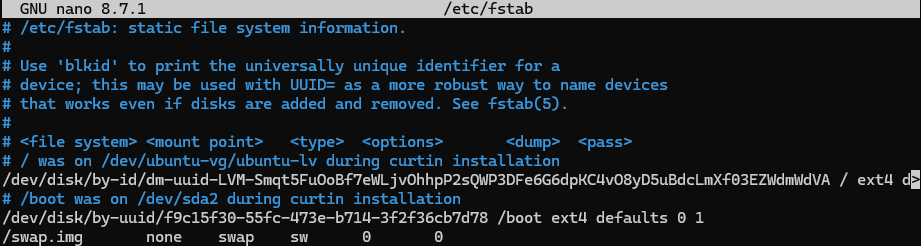

   ```text
   192.168.56.101:/srv/admin_tools /mnt/admin_tools nfs defaults,_netdev 0 0
   192.168.56.101:/srv/dev_projects /mnt/dev_projects nfs defaults,_netdev 0 0
   ```

2. Executar `mount -a` per provar les entrades sense reiniciar.

   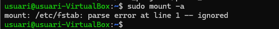

   ```bash
   sudo mount -a
   ```

### Resum

L'exercici mostra la configuració bàsica d'un servidor NFS, els usuaris i grups, els permisos, les exportacions i el muntatge al client. Les captures i els comandos transcrits s'han conservat tal com apareixen a les evidències.
