### Fase 1. Preparació de l'entorn

Per al client utilitzarem Zorin OS 18 amb configuració de xarxa NAT. El servidor tindrà una interfície amb xarxa només amb amfitrió i l'altra amb xarxa NAT. Això permetrà que el client tingui accés a Internet i que el servidor pugui comunicar-se amb ell.

<<<<<<< HEAD


Ens assegurarem que ambdues màquines tinguin accés a Internet i que es puguin comunicar entre elles a través de la xarxa només-amb-amfitrió. També actualitzarem els sistemes amb les últimes actualitzacions disponibles.
=======
Ens assegurarem que ambdues màquines tinguin accés a Internet i es puguin comunicar a través de la xarxa només amb amfitrió. També actualitzarem els sistemes.

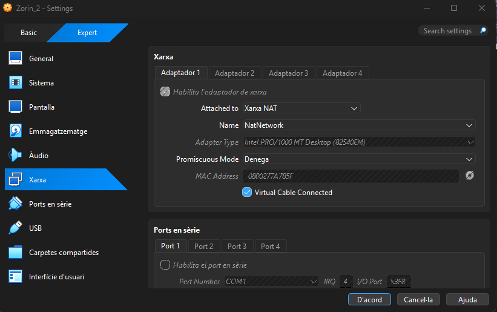

Sense comanda visible (captura de configuració gràfica).

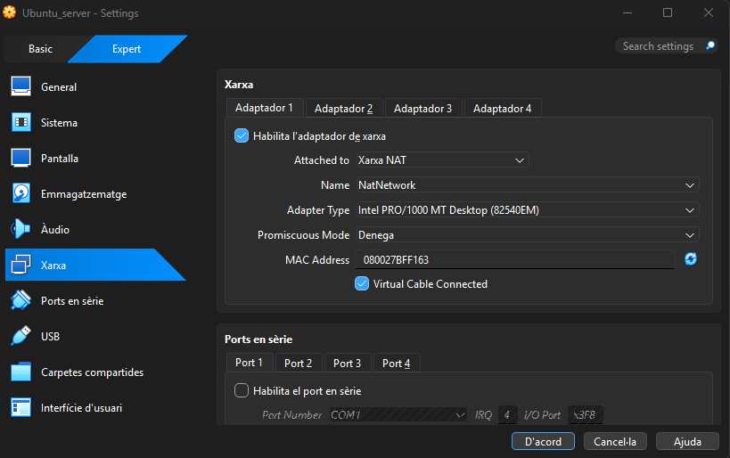

Sense comanda visible (captura de configuració gràfica).
>>>>>>> ea0342a3b8df5229d627b5e086a4e8092a3cc0e6

### Fase 2: Preparació del servidor

Abans de compartir recursos, preparem els usuaris, els grups i els directoris al servidor i al client.

1. Creació de grups: `devs` i `admins`.

<<<<<<< HEAD


2. Creació d'usuaris:
   Crear un usuari `dev01` (membre del grup `devs`).


3. Crear un usuari `admin01` (membre del grup `admins`).


4. Creació de directoris (al servidor):
   - Crear el directori per als projectes de desenvolupament: `/srv/nfs/dev_projects`
   - Crear el directori per a les eines d'administració: `/srv/nfs/admin_tools`


5. Permisos del servidor:
   - Els developers tindran control sobre els seus projectes.
   - Els administradors tindran control sobre les seves eines.
   - En ambdós casos, l'usuari propietari serà `root`.


6. Instal·lació del servei NFS.


> Nota: Perquè aquesta pràctica funcioni correctament, cal replicar aquests usuaris i grups al client i assegurar-se que UID i GID coincideixen a les dues màquines.

### Fase 3: L'exportació d'administració (el dilema de `root_squash`)


El client necessita que `/srv/nfs/admin_tools` sigui accessible per l'equip d'administradors. A vegades, l'usuari `root` del client necessitarà escriure en aquest directori per instal·lar eines. Aquí mostrarem un error típic i la seva solució.
=======
   **Servidor:**
   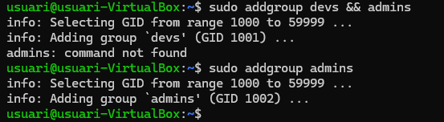

   ```bash
   sudo addgroup devs && admins
   sudo addgroup admins
   ```

   **Client:**
   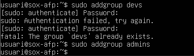

   ```bash
   sudo addgroup devs
   sudo addgroup admins
   ```

2. Creació d'usuaris `dev01` i `admin01`.

   **Client — assignació als grups:**
   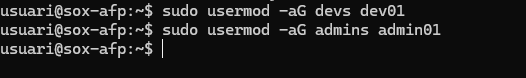

   ```bash
   sudo usermod -aG devs dev01
   sudo usermod -aG admins admin01
   ```

   **Servidor — creació d'usuaris:**
   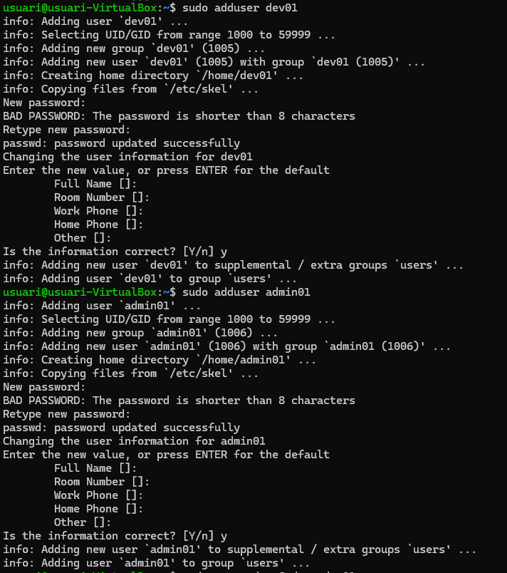

   ```bash
   sudo adduser dev01
   sudo adduser admin01
   ```

3. Creació de directoris al servidor:

   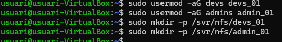

   ```bash
   sudo mkdir -p /srv/nfs/devs_01
   sudo mkdir -p /srv/nfs/admin_01
   ```

4. Comprovació de propietaris i permisos:

   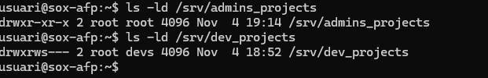

   ```bash
   ls -ld /srv/admins_projects
   ls -ld /srv/dev_projects
   ```

5. Instal·lació del servei NFS al servidor i del client NFS al client.

   **Servidor:**
   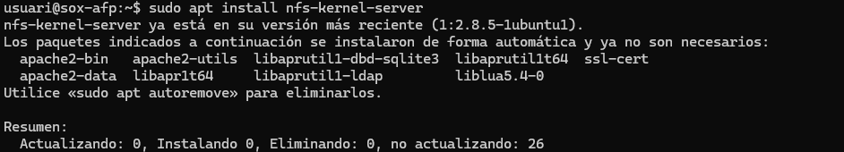

   ```bash
   sudo apt install nfs-kernel-server
   ```

   **Client:**
   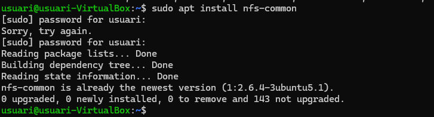

   ```bash
   sudo apt install nfs-common
   ```

> Nota: Perquè aquesta pràctica funcioni correctament, cal replicar els usuaris i grups al client i assegurar que UID i GID coincideixen a les dues màquines.

### Fase 3: L'exportació d'administració (el dilema de `root_squash`)

El client necessita accedir a `/srv/nfs/admin_tools`. Aquesta fase mostra la configuració de les exportacions i les proves des del client.
>>>>>>> ea0342a3b8df5229d627b5e086a4e8092a3cc0e6

1. Al servidor, configurar i recarregar les exportacions NFS.

   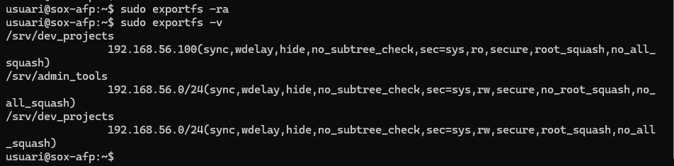

<<<<<<< HEAD


2. Des del client, muntar aquest recurs compartit a `/mnt/admin_tools`. Com a root del client, intentar crear un fitxer dins d'aquest directori muntat.


3. Verificar quin és el propietari del fitxer creat. Per què? Justificar la resposta amb l'explicació tècnica de `root_squash`.


#### Prova 2 (la solució)
=======
   ```bash
   sudo exportfs -ra
   sudo exportfs -v
   ```

2. Al client, provar l'escriptura indicada a la captura.

   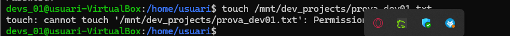
>>>>>>> ea0342a3b8df5229d627b5e086a4e8092a3cc0e6

   ```bash
   touch /mnt/dev_projects/prova_dev01.txt
   ```

<<<<<<< HEAD


2. Al client, desmuntar i tornar a muntar el recurs compartit.


3. Com a root del client, intentar crear un fitxer dins d'aquest directori muntat. Observeu quin és el propietari del fitxer creat aquesta vegada. Ha canviat alguna cosa? Justificar la resposta amb l'explicació tècnica de `no_root_squash`.
=======
3. Al client, comprovar els recursos muntats.

   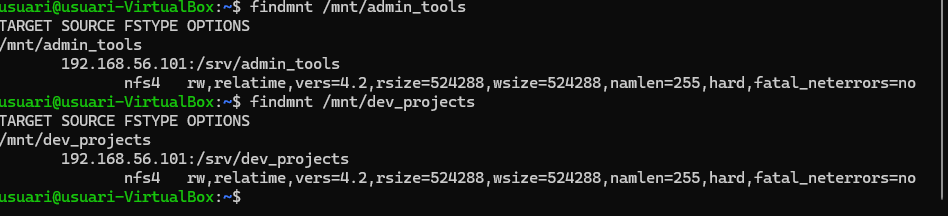

   ```bash
   findmnt /mnt/admin_tools
   findmnt /mnt/dev_projects
   ```
>>>>>>> ea0342a3b8df5229d627b5e086a4e8092a3cc0e6


### Fase 4: L'exportació de desenvolupament (permisos `rw` vs `ro`)

<<<<<<< HEAD


1. Editar `/etc/exports` per afegir dues exportacions per al mateix directori. El client vol que la xarxa d'administració pugui escriure-hi, però que la xarxa de consultors només la pugui llegir.


2. Des del client, muntar el recurs compartit a `/mnt/dev_projects` i provar d'escriure-hi com a usuari `dev01`.


3. Desmuntar el recurs i canviar la IP del client a 192.168.56.150. Tornar a provar d'escriure al directori muntat com a usuari `dev01` i comprovar que només funciona la lectura.


4. Canvieu d'usuari al client a `admin01` i torneu a provar d'escriure al directori muntat. Comproveu que no es pot escriure, ja que `admin01` no és membre del grup `devs` i els permisos locals del sistema de fitxers no ho permeten.
=======
1. Al client, provar de muntar el recurs NFS de desenvolupament.

   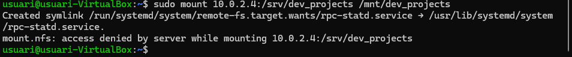

   ```bash
   sudo mount 10.0.2.4:/srv/dev_projects /mnt/dev_projects
   ```

2. Com a `dev01`, provar d'escriure al directori compartit.

   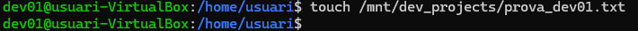

   ```bash
   touch /mnt/dev_projects/prova_dev01.txt
   ```

3. Com a administrador al client, comprovar la denegació d'escriptura.

   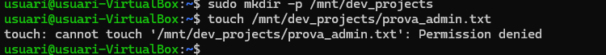

   ```bash
   sudo mkdir -p /mnt/dev_projects
   touch /mnt/dev_projects/prova_admin.txt
   ```

4. Es pot desmuntar el recurs amb:

   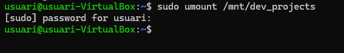

   ```bash
   sudo umount /mnt/dev_projects
   ```

5. Al servidor, assignar els grups propietaris com es mostra a la captura.

   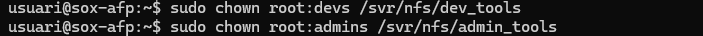

   ```bash
   sudo chown root:devs /srv/nfs/dev_tools
   sudo chown root:admins /srv/nfs/admin_tools
   ```
>>>>>>> ea0342a3b8df5229d627b5e086a4e8092a3cc0e6


### Fase 5: Muntatge automàtic amb `/etc/fstab`

1. Configurar les entrades NFS al fitxer `/etc/fstab` del client.

<<<<<<< HEAD


1. Editar el fitxer `/etc/fstab` al client per afegir les entrades necessàries per muntar automàticament els recursos compartits NFS durant l'inici del sistema.


2. Executar la comanda `mount -a` per provar les entrades sense reiniciar.


3. Reiniciar el client i verificar que els recursos compartits s'han muntat correctament.
=======
   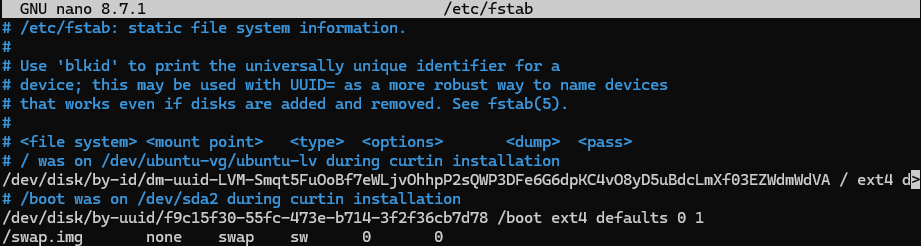

   ```text
   192.168.56.101:/srv/admin_tools /mnt/admin_tools nfs defaults,_netdev 0 0
   192.168.56.101:/srv/dev_projects /mnt/dev_projects nfs defaults,_netdev 0 0
   ```

2. Executar `mount -a` per provar les entrades sense reiniciar.

   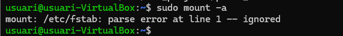

   ```bash
   sudo mount -a
   ```
>>>>>>> ea0342a3b8df5229d627b5e086a4e8092a3cc0e6


### Resum

L'exercici mostra la configuració bàsica d'un servidor NFS, els usuaris i grups, els permisos, les exportacions i el muntatge al client. Les captures i els comandos transcrits s'han conservat tal com apareixen a les evidències.
