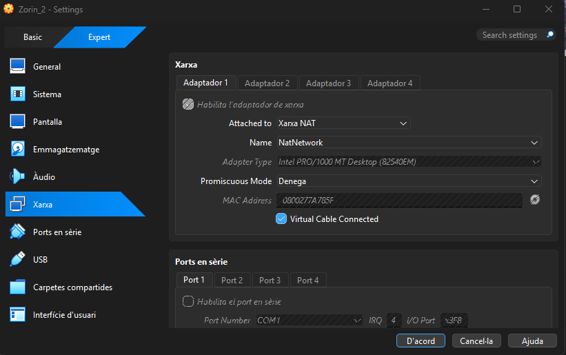
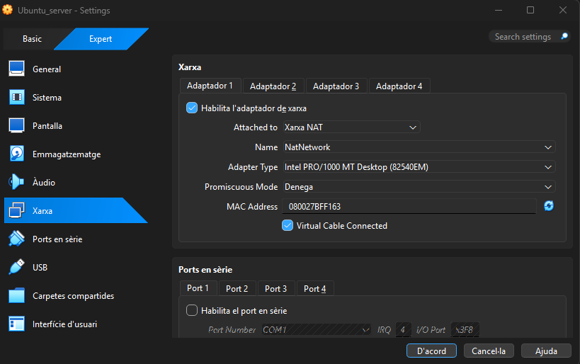
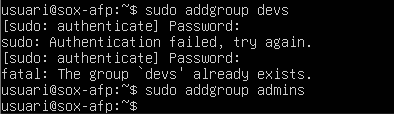
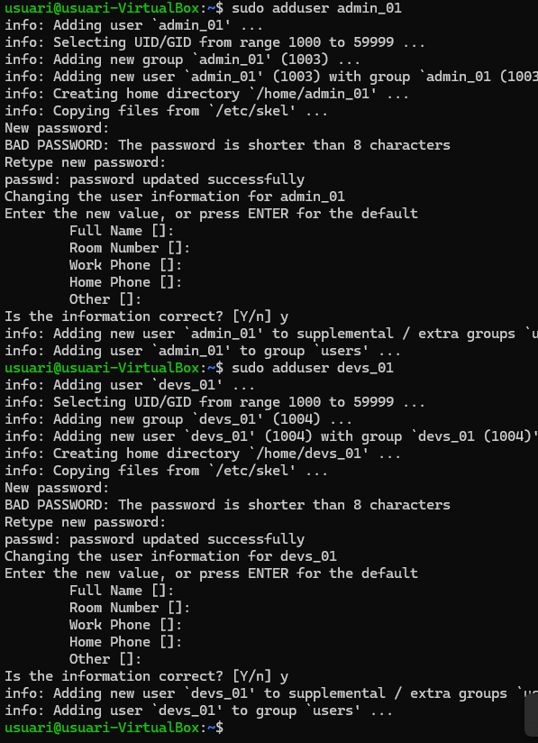
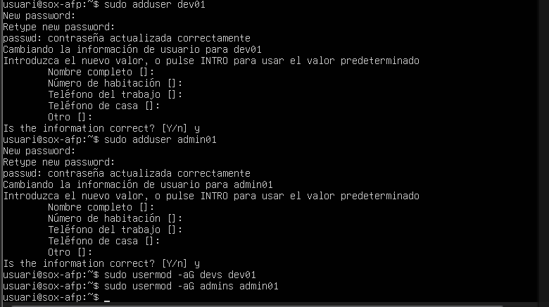
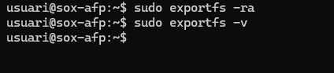
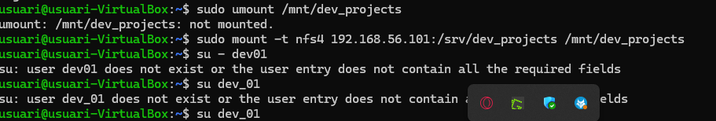
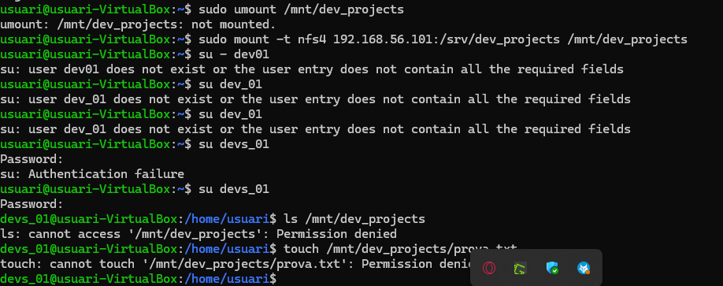
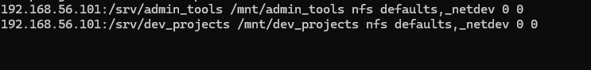

### Fase 1. Preparació de l'entorn

Per al client, utilitzarem Zorin OS 18 amb configuració de "xarxa NAT". El server tindrem la interfície per treballar amb "xarxa només-amb-amfitrió" i l'altra amb "xarxa NAT". Això ens permetrà que el client tingui accés a Internet i que el servidor pugui comunicar-se amb el client.





Ens assegurarem que ambdues màquines tinguin accés a Internet i que es puguin comunicar entre elles a través de la xarxa només-amb-amfitrió i actualitzarem els sistemes amb les últimes actualitzacions disponibles.

### Fase 2: Preparació del servidor

Abans de compartir res, hem de preparar els usuaris i els directoris al Servidor.

1. Creació de Grups:
Crear dos grups per al client: devs i admins.


```bash
sudo addgroup devs && admins
sudo addgroup admins
```



```bash
sudo addgroup devs
sudo addgroup admins
```

2. Creació d'Usuaris:
Crear un usuari dev01 (membre del grup devs).



```bash
sudo adduser admin_01
sudo adduser devs_01
```


```bash
sudo usermod -aG devs devs_01
sudo usermod -aG admins admin_01
```

3. Crear un usuari admin01 (membre del grup admins).


```bash
sudo adduser admin_01
sudo adduser devs_01
```



```bash
sudo adduser devel
sudo adduser adminot
sudo usermod -aG devs devot
sudo usermod -aG admins admino1
```

4. Creació de Directoris (al Servidor):
    - Crear el directori per als projectes de desenvolupament: `/srv/nfs/dev_projects`
    -Crear el directori per a les eines d'administració: `/srv/nfs/admin_tools`


```bash
sudo mkdir -p /mnt/admin_tools
sudo mkdir -p /mnt/dev_projects
```


```bash
sudo mkdir -p /mnt/admin_tools /mnt/dev_projects
sudo nano /etc/fstab
```

5. Permisos del Servidor (El punt clau):
    - Es vol que els developers tinguin control total sobre els seus projectes.
    - Es vol que els administradors tinguin control sobre les seves eines.
    - En tots dos casos, l'usuari propietari serà root.


```bash
sudo chown root:devs /svr/nfs/dev_tools
```


```bash
sudo chown root:admins /svr/nfs/admin_tools
```

6. Com a pas final, s'instal·laran els paquets necessaris per al servei NFS al servidor i es configurarà l'exportació dels directoris amb les opcions adequades.


> Nota: Perquè aquesta pràctica funcioni correctament, heu de replicar aquests usuaris i grups al client, o, idealment, assegurar-vos que els UID i GID (els números d'identificació) coincideixin a les dues màquines.

### Fase 3: L'Exportació d'Administració (El Dilema del root_squash)



```bash
sudo exportfs -ra
sudo exportfs -v
```

El client necessita que el directori /srv/nfs/admin_tools sigui accessible per l'equip d'administradors. A vegades, l'usuari root del client (que sou vosaltres, els consultors) necessitarà escriure en aquest directori per instal·lar eines. Aquí mostrarem un error típic i la seva solució.

#### Prova 1 (L'error comú)

1. Exportar el directori `/srv/nfs/admin_tools` amb les opcions 'rw,sync'.


```bash
sudo exportfs -ra
sudo exportfs -v
```


```bash
sudo nano /etc/exports
```

2. Des del client, muntar aquest recurs compartit a `/mnt/admin_tools`. Com a root del client, intentar crear un fitxer dins d'aquest directori muntat.



```bash
sudo umount /mnt/dev_projects
sudo mount -t nfs4 192.168.56.101:/srv/dev_projects /mnt/dev_projects
su - dev@l
su dev_61
su dev_01
```

3. Verificar quin és el propietari del fitxer creat. Per què? Justificar la resposta amb l'explicació tècnica de 'root_squash'.


```bash
touch /mnt/dev_projects/prova_dev01.txt
```

#### Prova 2 (La Solució)

1. Modificar l'exportació del directori `/srv/nfs/admin_tools` per incloure l'opció 'no_root_squash'.


```bash
sudo chown root:admins /svr/nfs/admin_tools
```

2. Al client, desmuntar i tornar a muntar el recurs compartit.



```bash
sudo umount /mnt/dev_projects
sudo mount -t nfs4 192.168.56.101:/srv/dev_projects /mnt/dev_projects
su - dev@1
su dev_61
su dev_61
su devs_61
su devs_61
ls /mnt/dev_projects
touch /mnt/dev_projects/prova.txt
```

3. Com a root del client, intentar crear un fitxer dins d'aquest directori muntat. Observeu quin és el propietari del fitxer creat aquesta vegada. Ha canviat alguna cosa? Justificar la resposta amb l'explicació tècnica de 'no_root_squash'.


```bash
sudo chown root:admins /svr/nfs/admin_tools
```

### Fase 4: L'Exportació de Desenvolupament (Permisos rw vs ro)


```bash
sudo exportfs -ra
sudo exportfs -v
```

1. Editar /etc/exports per afegir dues exportacions per al mateix directori. El client vol que la xarxa d'administració (p.ex., 192.168.56.0/24) hi pugui escriure, però que la xarxa de consultors (simularem que és una altra IP, p.ex., 192.168.56.150) només pugui llegir.

   > Si les dues màquines es veuen per xarxa NAT, useu una IP consistent amb el rang de la xarxa NAT. Per exemple, per exemple, 10.0.2.100.


```bash
/srv/dev_projects 10.0.2.15/2U(rw, sync,no_subtree_check)
/srv/dev_projects 10.0.2.15(ro, sync,no_subtree_check)
```

2. Des del client, muntar el recurs compartit a `/mnt/dev_projects` i provar d'escriure-hi com a usuari dev01. Hauria de funcionar.


```bash
sudo mount 10.0.2.4:/srv/dev_projects /mnt/dev_projects
```

3. Desmuntar el recurs i canviar manualment la IP del client a 192.168.56.100. Tornar a provar d'escriure al directori muntat com a usuari dev01 i comprovar que només funciona la lectura.


```bash
sudo mkdir -p /mnt/dev_projects
```

4. Canvieu d'usuari al client a admin01 i torneu a provar d'escriure al directori muntat. Comproveu que no es pot escriure, ja que admin01 no és membre del grup devs (permisos locals del sistema de fitxers).


```bash
touch /mnt/dev_projects/prova_admin.txt
```

### Fase 5: Muntatge Automàtic amb /etc/fstab

És evident que els usuaris no poden estar muntant manualment els recursos compartits cada vegada que reinicien el sistema. Per això, es configurarà el muntatge automàtic mitjançant el fitxer /etc/fstab al client.



```bash
192.168.56.101:/srv/admin_tools /mnt/admin_tools nfs defaults,_netdev 0 0
192.168.56.101:/srv/dev_projects /mnt/dev_projects nfs defaults,_netdev 0 0
```

1. Editar el fitxer /etc/fstab al client per afegir les entrades necessàries per muntar automàticament els recursos compartits NFS al directori `/mnt/admin_tools` i `/mnt/dev_projects` durant l'inici del sistema.


```bash
192.168.56.101:/srv/admin_tools /mnt/admin_tools nfs defaults,_netdev 0 0
192.168.56.101:/srv/dev_projects /mnt/dev_projects nfs defaults,_netdev 0 0
```

2. Executar la comanda `mount -a` per provar les entrades sense reiniciar.


```bash
sudo umount /mnt/dev_projects
sudo mount -t nfs4 192.168.56.101:/srv/dev_projects /mnt/dev_projects
su - dev@l
su dev_61
su dev_01
```

3. Reiniciar el client i verificar que els recursos compartits s'han muntat correctament.


```bash
findmnt /mnt/admin_tools
findmnt /mnt/dev_projects
```
