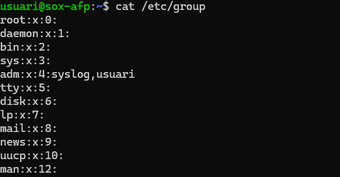
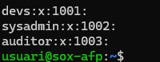
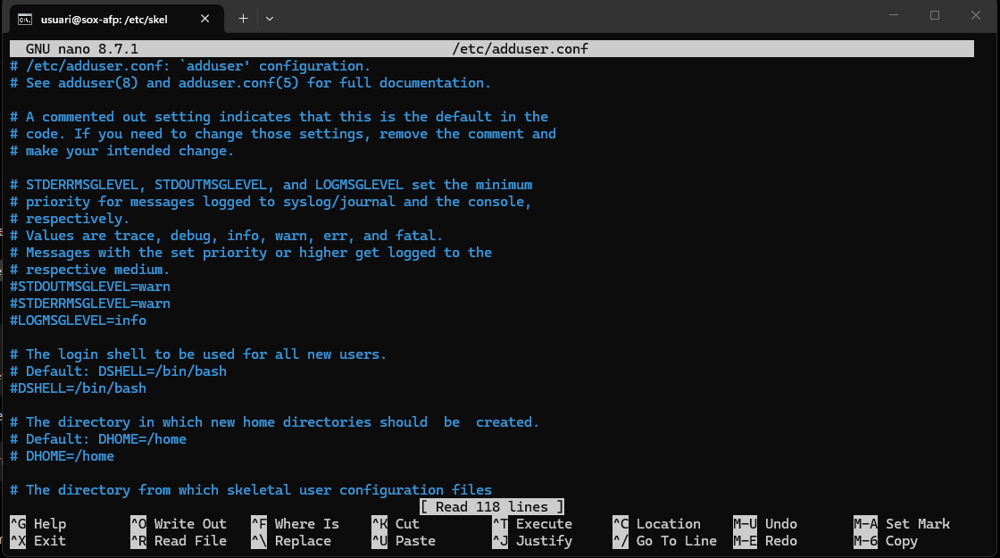
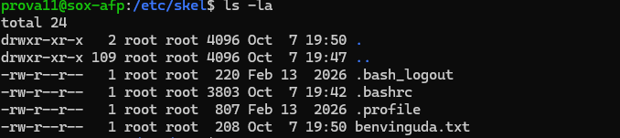

# NF1.UD3. Usuaris i grups

## Objectiu de la tasca

L’objectiu d’aquesta tasca és practicar l’administració d’usuaris i grups a Ubuntu Server. S’han creat els grups necessaris i diversos usuaris amb els seus directoris personals i shells corresponents. També s’ha configurat el fitxer de benvinguda, l’estructura de `/etc/skel` i l’àlies `ll`; s’han comprovat els fitxers del sistema relacionats amb els comptes, s’ha gestionat el bloqueig i desbloqueig d’un usuari, s’ha eliminat un compte i s’ha configurat el shell Fish per a `laura_dev`.

## Creació de la jerarquia de grups

Les ordres següents creen els grups devs, sysadmin i auditor.


```bash
sudo addgroup devs
sudo addgroup sysadmin
sudo addgroup auditor

```

Aquesta captura mostra el contingut del fitxer /etc/group, on es poden consultar els grups del sistema.





```bash
cat /etc/group
```
Aquesta imatge mostra els grups creats per a la pràctica.

## Gestió dels perfils d'usuari

S’obre el fitxer benvinguda.txt amb l’editor nano per escriure el missatge de benvinguda que tindrà l’usuari de prova.


```bash
nano ~/benvinguda.txt
```

En aquesta captura es veu el contingut escrit dins del fitxer de benvinguda.


Es crea el directori Documents dins de l’estructura que s’utilitzarà per als nous usuaris.


```bash
mkdir -p ~/Documents
```

S’entra al directori plantilla /etc/skel i s’edita el fitxer .bashrc per configurar l’àlies ll.


```bash
cd /etc/skel
sudo nano .bashrc
```
Una vegada en el directori /etc/skel posem la comanda perque can posem alies ll surti  ls -la --color=auto

```bash
alias ll='ls -la --color=auto'
```


Es comprova que l’àlies ll executa ls -la --color=auto.


```bash
alias ll
```

S’edita la configuració d’adduser per comprovar que el shell per defecte és Bash.


```bash
sudo nano /etc/adduser.conf
```

En aquesta captura es comprova la ruta del shell Bash.




Es crea l’usuari de prova prova1.


```bash
sudo adduser prova1
```

Es comprova el contingut del directori personal de l’usuari que acabem de crear.


```bash
ls -la
```

## Creació i configuració d’usuaris

Ara creem els usuaris pau_dev i laura_dev.


```bash
sudo adduser pau_dev
sudo adduser laura_dev
```

Es creen els usuaris marc_sys i auditor, amb les diferents comandes:
- -M: Serveix per crear direcoris
- -D: S'utilitza per marcar la ruta hon volem que estigui el direcortri
- -S: Es per definir la terminal que ulizitzara
- -G: Es per agregarlo al grup directament
- -C: Serveix per si vols posar alguna descripico al conte 


```bash
sudo useradd -m -d /home/marc_sys -s /bin/bash -g sysadmin -G devs -c "Marc Soler" marc_sys
sudo useradd -m -d /home/auditor -s /bin/bash -g sysadmin -G devs -c "Marc Soler" auditor 

```

S’afegeixen els usuaris als grups secundaris que els corresponen.


```bash
sudo usermod -aG devs pau_dev
sudo usermod -aG devs laura_dev
sudo usermod -aG devs marc_sys
sudo usermod -aG auditor auditor

```

## Inspecció del sistema i fitxers de configuració

La comanda id permet comprovar l’identificador d’usuari, el grup principal i els grups secundaris de marc_sys.


```bash
id marc_sys
```

S’inicia una sessió com a pau_dev per veure que tot esta bé.

```bash
su pau_dev
```

Es consulta /etc/passwd, que conté informació dels comptes d’usuari.


```bash
cat /etc/passwd
```

Es consulta /etc/shadow,es el lloc hon estan les contraseñes guardades pero estan ecriptades per que la gent no la pugui llegir.


```bash
sudo cat /etc/shadow
```
Quin és el directori plantilla que s'utilitza per omplir el /home d'un usuari nou quan es crea? 

- El direcotri plantilla que s'utiliza es /etc/skel

Quina comanda o fitxer en defineix aquesta configuració?

- useradd -d

## Manteniment, bloqueig i eliminació

Es bloqueja el compte pau_dev amb passwd -l.


```bash
sudo passwd -l pau_dev
```

Es comprova l’estat del compte després de bloquejar-lo.


```bash
cat /etc/passwd
```

Es desbloqueja el compte pau_dev amb passwd -u.


```bash
sudo passwd -u pau_dev
```

S’elimina el compte auditor i el seu directori personal amb la comanda -r.


```bash
sudo deluser -r auditor
```

## Personalització de l’entorn d’usuari

S’instal·la el shell Fish mitjançant el gestor de paquets d’Ubuntu.


```bash
sudo apt install fish
```


Es canvia el shell per defecte de laura_dev a Fish.


```bash
sudo chsh -s /usr/bin/fish laura_dev
```

Finalment, s’inicia sessió com a laura_dev per comprovar que Fish s’executa correctament.


```bash
su - laura_dev
```

Ara veurem shell que tenim posat en el conte de laura_dev


```bash
echo $SHELL
```