# Tasca addicional: servidor d'impressió CUPS

En aquesta documentació es recullen els passos realitzats per instal·lar i configurar CUPS al servidor, compartir la impressora virtual `cups-pdf` i comprovar-ne el funcionament des d'un client Zorin OS.

## 1. Instal·lació de CUPS al servidor

S'actualitzen els repositoris i s'instal·la el servei CUPS.

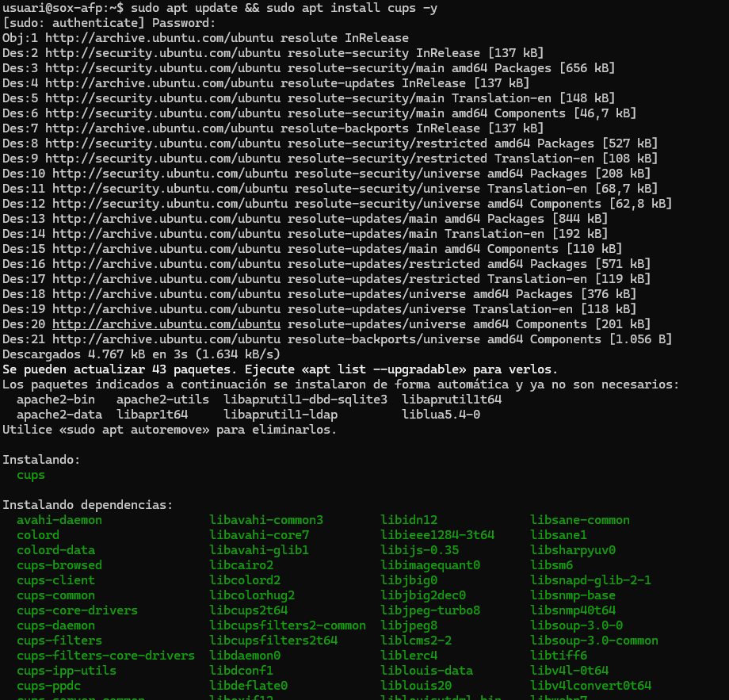

**Comanda que apareix a la imatge:**

```bash
sudo apt update && sudo apt install cups -y
```

S'inicia el servei i se'n comprova l'estat. La sortida mostra que `cups.service` està actiu i en execució.

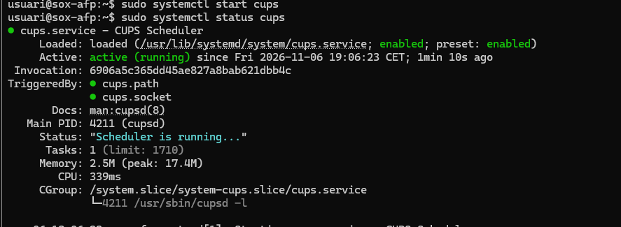

**Comandes que apareixen a la imatge:**

```bash
sudo systemctl start cups
sudo systemctl status cups
```

## 2. Instal·lació de la impressora virtual cups-pdf

S'instal·la el controlador de la impressora virtual, que permet generar documents PDF en lloc d'imprimir en paper.

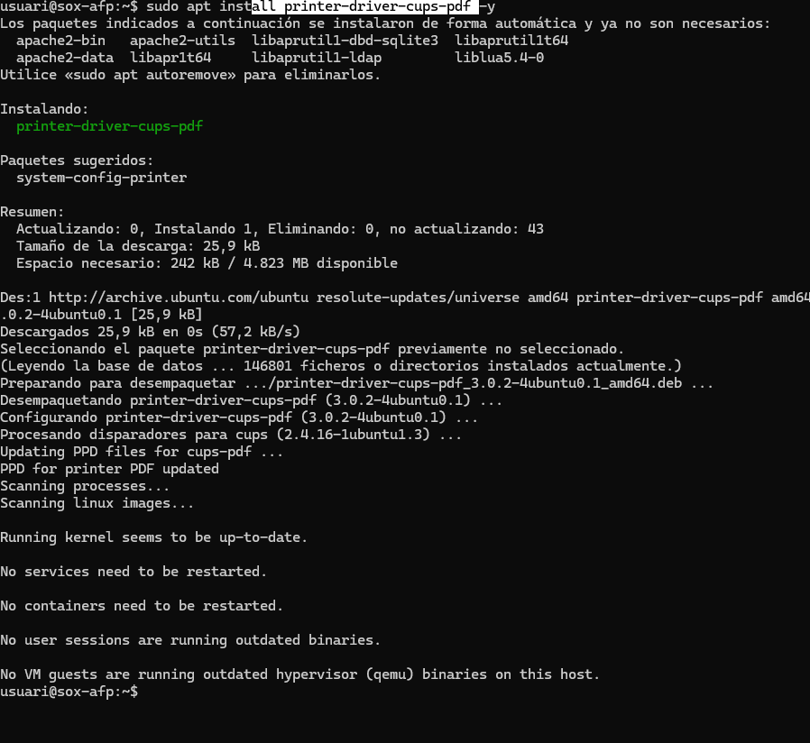

**Comanda que apareix a la imatge:**

```bash
sudo apt install printer-driver-cups-pdf
```

## 3. Configuració de l'administració de CUPS

S'edita el fitxer de configuració `/etc/cups/cupsd.conf` per permetre que CUPS escolti connexions a través de les interfícies de xarxa. A la captura es veu la configuració amb el port 631.

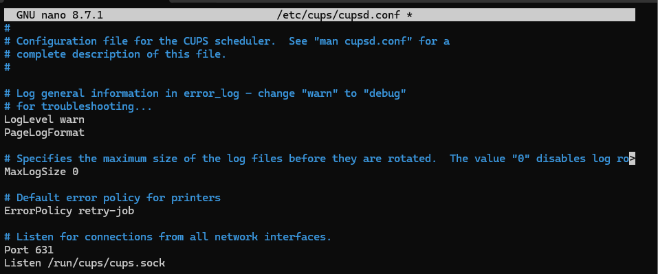

**Comanda d'edició (no es veu a la captura):**

```bash
sudo nano /etc/cups/cupsd.conf
```

**Configuració que es veu a la imatge:**

```conf
Port 631
Listen /run/cups/cups.sock
```

## 4. Accés a la interfície web i compartició de la impressora

Es comprova que la interfície web de CUPS és accessible des del navegador del servidor.

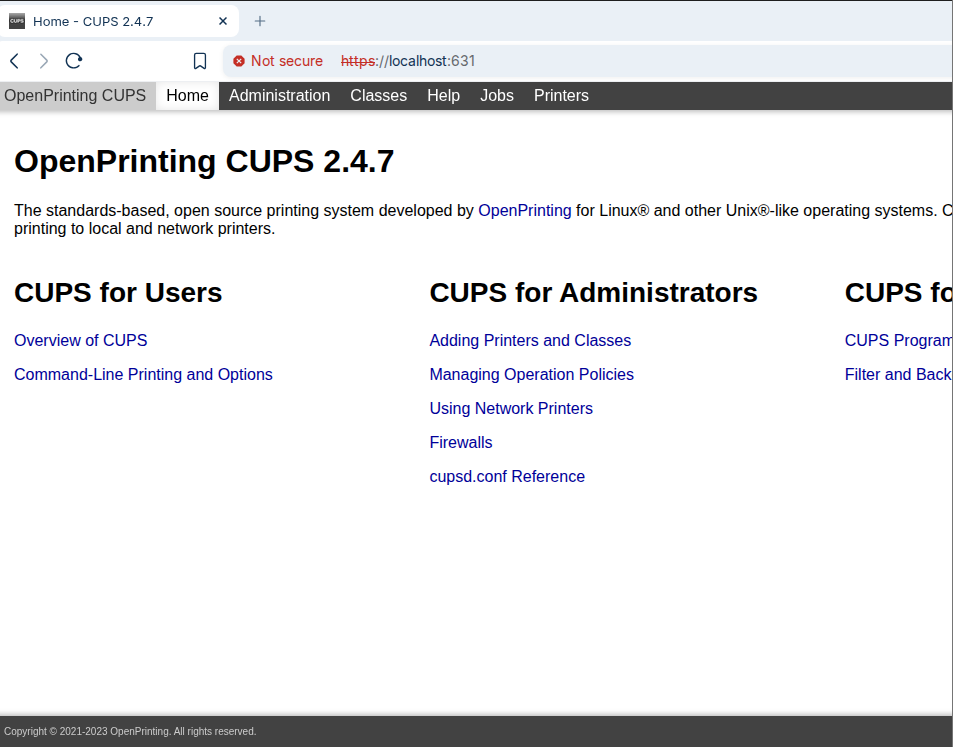

**Adreça que apareix a la imatge:**

```text
https://localhost:631
```

A continuació, es comprova que la impressora virtual `PDF` està donada d'alta i apareix a la llista d'impressores.

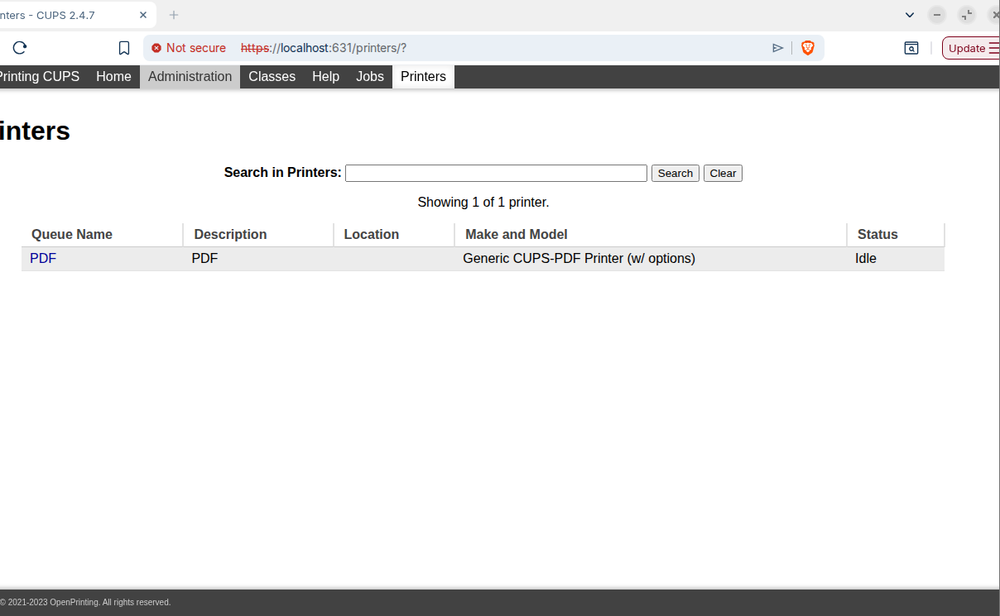

**Comanda:** no n'hi ha cap de visible; la comprovació es fa des de la interfície web de CUPS.

Des de l'apartat d'administració es poden activar les opcions per compartir impressores i permetre l'administració remota.

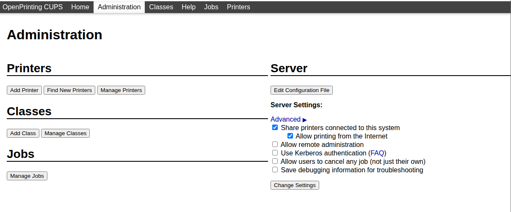

**Comanda:** no n'hi ha cap de visible; els canvis es fan des de la interfície web.

S'accedeix a la modificació de la impressora `PDF` i es marca l'opció per compartir-la.

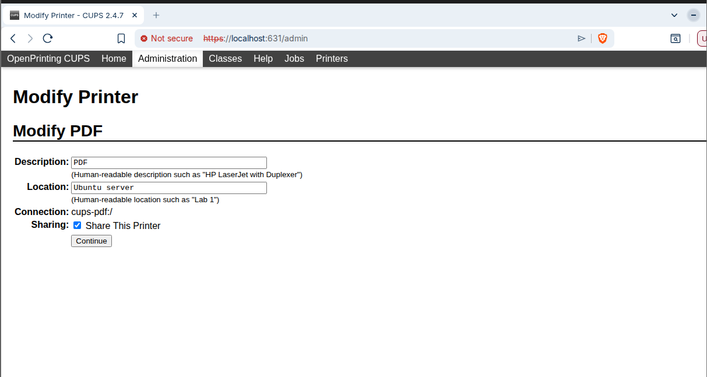


La pàgina de la impressora mostra les seves dades i l'estat de la cua.

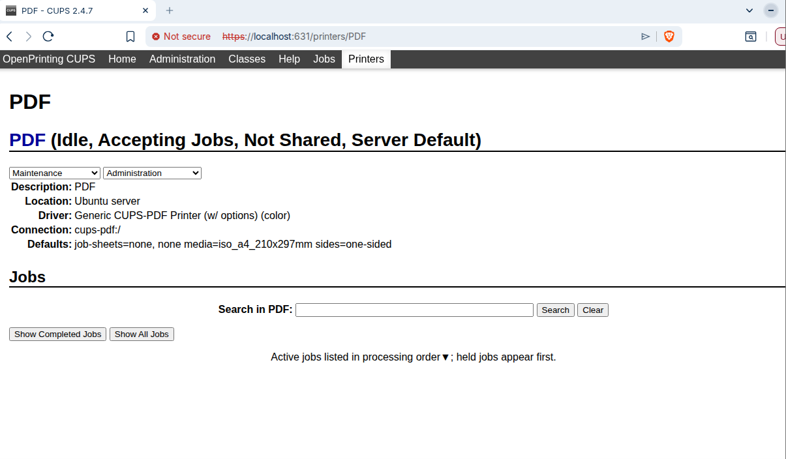

**Comanda:** no n'hi ha cap de visible; és la pàgina de detall de la impressora a CUPS.

## 5. Configuració del client Zorin OS

Al client s'actualitzen els repositoris i s'instal·len els paquets necessaris per treballar amb CUPS i configurar impressores gràficament.

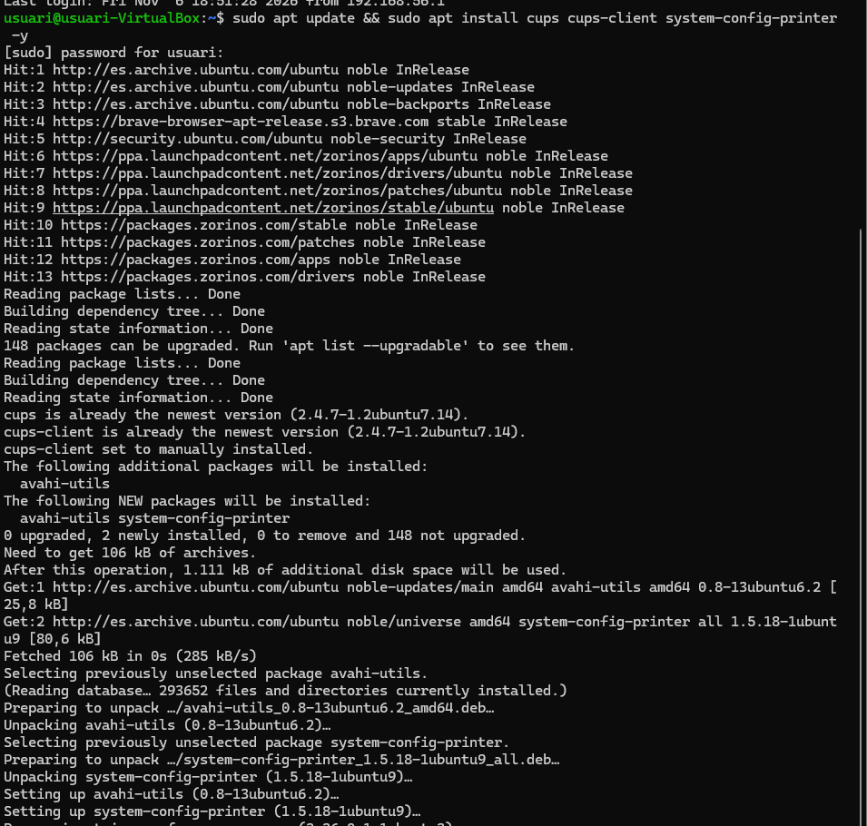

**Comanda que apareix a la imatge:**

```bash
sudo apt update && sudo apt install cups cups-client system-config-printer
```

Es comprova des de la configuració del sistema que la impressora PDF apareix al client amb estat preparat.

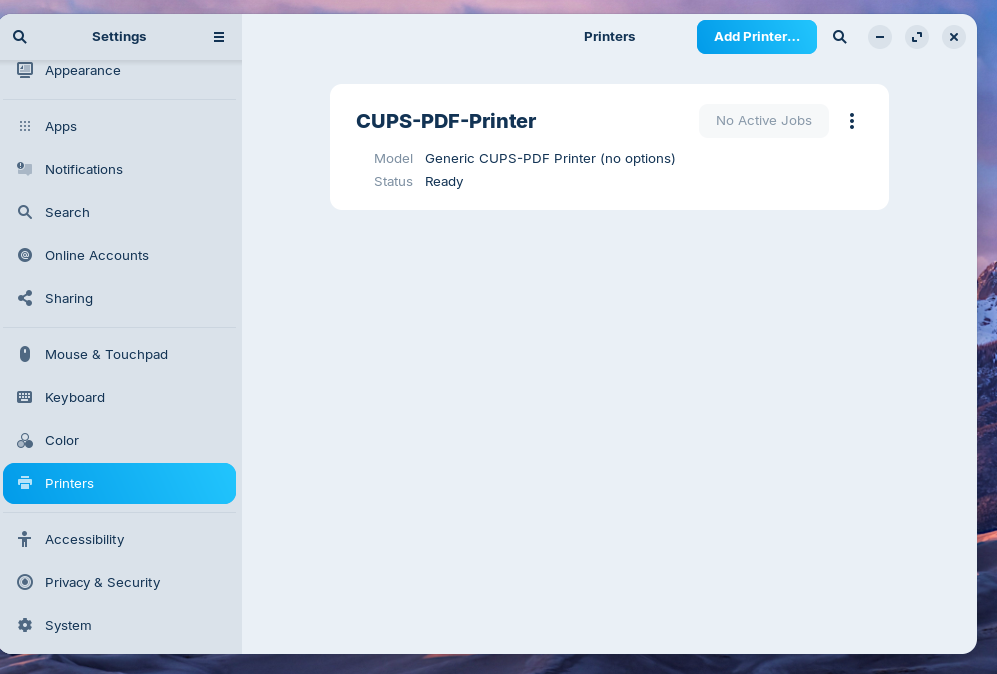

**Comanda:** no n'hi ha cap de visible; la comprovació es fa des de l'aplicació de configuració d'impressores.

## 6. Activació de la cua i proves d'impressió

S'habilita la impressora `PDF` i s'accepten treballs a la seva cua.


**Comandes que apareixen a la imatge:**

```bash
sudo cupsenable PDF
sudo cupsaccept PDF
```

Al client es crea un fitxer de text de prova.


**Comanda que apareix a la imatge:**

```bash
echo "Prova definitiva CUPS" > prova_final.txt
```

S'envia el fitxer a la impressora compartida `ImpressoraServidor`. La resposta indica que s'ha creat el treball d'impressió número 5.

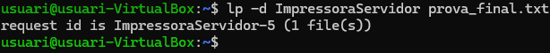

**Comanda que apareix a la imatge** (a la captura es veu `Lp`; la comanda correcta de Linux és `lp`):

```bash
lp -d ImpressoraServidor prova_final.txt
```

## 7. Comprovació dels treballs d'impressió

Finalment, es consulta la cua de sortida per verificar que els treballs s'han enviat a CUPS. A la captura apareixen els treballs de `CUPS-PDF-Printer` i `ImpressoraServidor`, inclòs el número 5.

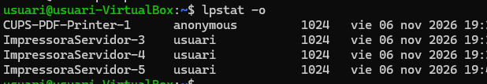

**Comanda que apareix a la imatge** (a la captura es veu `Lpstat`; la comanda correcta és `lpstat`):

```bash
lpstat -o
```

Aquesta última comprovació permet verificar que els treballs han arribat a la cua d'impressió. Les captures incloses documenten els passos realitzats i les ordres que s'hi mostren.
